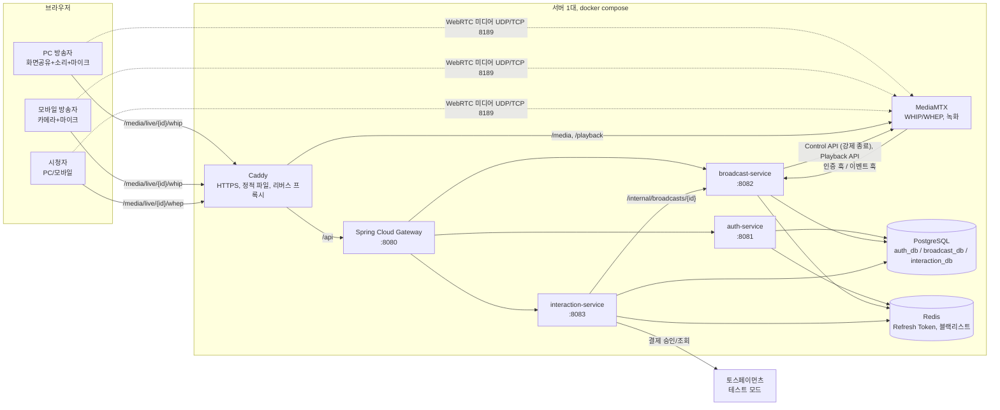
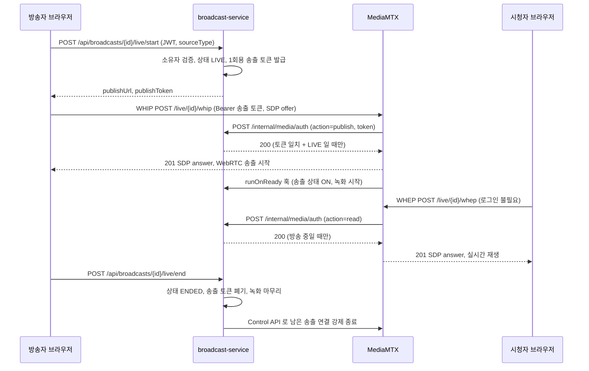

# LiveBroadcast

브라우저만으로 PC 화면 공유 방송과 모바일 카메라 방송을 송출하고, 다른 기기에서 실시간으로 시청할 수 있는 라이브 방송 플랫폼입니다.
백엔드는 Spring Boot 기반 MSA(Gateway + 3개 서비스), 각 서비스 내부는 헥사고날 구조(app / in / out / domain)로 구성했습니다.

## 서비스 주소

| 항목 | 값 |
| --- | --- |
| 서비스 URL | `https://<배포 도메인>` (배포 후 이 칸을 실제 주소로 바꿔 주세요) |
| 배포 가이드 | [docs/DEPLOY.md](docs/DEPLOY.md) |

## 테스트 계정

서버가 처음 뜰 때 테스트 계정 두 개가 자동으로 만들어집니다.
로그인 화면 아래 **평가용 테스트 계정으로 바로 로그인** 버튼을 누르면 비밀번호 입력 없이 바로 로그인됩니다.

| 아이디 | 비밀번호 | 닉네임 | 용도 |
| --- | --- | --- | --- |
| `tester1` | `test1234!` | 테스터1 | 방송 소유자 역할 |
| `tester2` | `test1234!` | 테스터2 | 다른 사용자 역할 (권한 거절 확인, 후원) |

> 비밀번호는 `.env` 의 `TEST_ACCOUNT_PASSWORD` 로 바꿀 수 있고, `TEST_ACCOUNTS_ENABLED=false` 로 기능 자체를 끌 수 있습니다.

## 구현 범위

| 구분 | 요구사항 | 구현 내용 |
| --- | --- | --- |
| 필수 | PC 라이브 방송 | `getDisplayMedia` 화면 공유 + 탭/시스템 소리 + 마이크를 Web Audio 로 합쳐 WHIP 으로 송출 |
| 필수 | 모바일 라이브 방송 | `getUserMedia` 카메라 + 마이크 송출, 전면/후면 카메라 전환 |
| 필수 | 방송 관리 및 시청 | 방송 CRUD, 목록/상세, WHEP 저지연 시청, READY/LIVE/ENDED 상태 관리, PostgreSQL 영구 저장 |
| 필수 | 인증 및 인가 | 회원가입/로그인/로그아웃, JWT(Access) + HttpOnly 쿠키(Refresh, Rotation), 로그아웃 시 Redis 블랙리스트, 서버측 소유자 검증 |
| 선택 | 댓글 | 방송별 댓글 CRUD, 작성자 검증, SSE 로 실시간 반영 |
| 선택 | 도네이션 | 토스페이먼츠 테스트 결제, 서버 승인 및 금액/주문/대상 검증, 행 잠금 + 유니크 제약 + 멱등키로 중복 적립 방지, 방송별 내역과 합계, 웹훅 처리 |
| 선택 | 녹화 및 다시보기 | MediaMTX 자동 녹화(fMP4), 녹화 메타데이터와 저장 위치 DB 저장, 목록/상세/재생 |

## 아키텍처



### 서비스 역할

| 서비스 | 책임 | 저장소 |
| --- | --- | --- |
| gateway | 외부 진입점, 라우팅, 내부 헤더 위조 차단, 요청 ID 부여 | - |
| auth-service | 회원, 로그인, 토큰 발급/갱신/폐기, 테스트 계정 | `auth_db`, Redis |
| broadcast-service | 방송 정보, 방송 상태, 송출 권한(토큰) 발급, MediaMTX 인증/이벤트 처리, 녹화 | `broadcast_db` |
| interaction-service | 댓글, 후원, 실시간 이벤트(SSE) | `interaction_db` |

서비스마다 데이터베이스를 분리했고, 다른 서비스 데이터가 필요하면 API 로 조회합니다.
예를 들어 후원 대상(방송자)은 브라우저가 보낸 값을 쓰지 않고 interaction-service 가 broadcast-service 내부 API 로 방송 소유자를 조회해서 정합니다.

### 송출과 시청 흐름



### 방송 상태 관리

- `status` 는 방송자가 바꾸는 **방송 상태**입니다. `READY`(등록만 됨) → `LIVE`(방송 중) → `ENDED`(종료), 종료된 방송은 다시 시작할 수 있습니다.
- `streamOnline` 은 MediaMTX 훅으로 갱신되는 **실제 송출 상태**입니다. 방송 중이어도 네트워크가 끊기면 `false` 가 됩니다.
- 종료 시 송출 토큰을 즉시 폐기하므로 같은 토큰으로 재송출할 수 없고, 커밋 후 MediaMTX Control API 로 남은 연결까지 끊습니다.
- 종료 버튼 없이 브라우저를 닫는 경우를 위해, 방송 중인데 송출이 3분(`STREAM_STALE_GRACE`) 이상 끊긴 방송은 스케줄러가 자동 종료합니다.
- 상태 변경(사용자 버튼과 미디어 서버 훅이 동시에 올 수 있음)은 `SELECT ... FOR UPDATE` 행 잠금으로 직렬화합니다.

## 기술 스택

| 영역 | 기술 |
| --- | --- |
| Backend | Java 25, Spring Boot 4.1, Spring Cloud Gateway (2025.1), Spring Security (OAuth2 Resource Server, Nimbus JWT), Spring Data JPA, Flyway |
| Data | PostgreSQL 17, Redis 7 |
| Streaming | MediaMTX 1.15 (WebRTC WHIP/WHEP, fMP4 녹화, Playback 서버) |
| Frontend | Vue 3, Vite, Pinia, Vue Router, axios |
| Infra | Docker Compose, Caddy 2 (HTTPS 자동 발급) |
| Payment | 토스페이먼츠 결제창 SDK v2, 결제 승인 API (테스트 모드) |

## 프로젝트 구조

```
LiveBroadcast
├── common/                    # 서비스 공통: JWT 검증, 로그아웃 블랙리스트, 내부 API 키 필터, 예외 응답
├── gateway/                   # Spring Cloud Gateway
├── auth-service/
├── broadcast-service/
├── interaction-service/
├── frontend/                  # Vue 3 SPA (+ Caddy 이미지)
├── infra/
│   ├── caddy/Caddyfile
│   ├── mediamtx/mediamtx.yml, hooks/notify.sh
│   └── postgres/init.sql
├── docs/DEPLOY.md
├── docker-compose.yml         # 전체 실행
└── docker-compose.dev.yml     # 로컬 개발용 인프라만 실행
```

각 서비스는 같은 헥사고날 패키지 규칙을 따릅니다. broadcast-service 예시입니다.

```
com.livebroadcast.broadcast
├── domain/                 # 순수 도메인 모델 (Broadcast, Recording, 상태 전이와 소유자 검증 규칙)
├── app/
│   ├── port/in/            # 유스케이스 인터페이스 (BroadcastCommandUseCase, LiveStreamUseCase ...)
│   ├── port/out/           # 외부 의존 인터페이스 (BroadcastRepositoryPort, MediaServerPort ...)
│   └── service/            # 유스케이스 구현
├── in/                     # 인바운드 어댑터
│   ├── web/                # REST 컨트롤러, DTO
│   ├── internal/           # MediaMTX 훅, 서비스 간 내부 API
│   └── scheduler/          # 송출 끊긴 방송 자동 종료
├── out/                    # 아웃바운드 어댑터
│   ├── persistence/        # JPA 엔티티, 리포지토리, 도메인 매핑
│   └── media/              # MediaMTX Control/Playback API 클라이언트
└── config/                 # 보안 설정
```

도메인 모델은 JPA 엔티티와 분리되어 있어 스프링 없이 단위 테스트할 수 있습니다.

## 실행 방법

### 1. 전체 실행 (Docker Compose, 권장)

필요 환경: Docker 24 이상, Docker Compose v2, 메모리 4GB 이상

```bash
git clone https://github.com/dekim2018/LiveBroadcast.git
cd LiveBroadcast

# 무작위 비밀 값으로 .env 생성 (로컬)
./scripts/generate-env.sh
# 운영 서버라면: ./scripts/generate-env.sh <도메인> <서버 공인 IP>

# 후원 기능을 쓰려면 .env 에 토스 테스트 키 입력
#   TOSS_CLIENT_KEY=test_ck_...
#   TOSS_SECRET_KEY=test_sk_...

docker compose up -d --build
docker compose logs -f broadcast-service   # 기동 확인
```

브라우저에서 `http://localhost` 로 접속합니다. 첫 빌드는 Gradle 과 npm 의존성을 받느라 5~10분 정도 걸립니다.

### 2. 환경변수 예시 (`.env`)

```dotenv
SITE_ADDRESS=http://localhost        # 운영: mylive.duckdns.org (도메인만 적으면 HTTPS 자동)
PUBLIC_HOST=127.0.0.1                # 운영: 서버 공인 IP (WebRTC 미디어 주소)
COOKIE_SECURE=false                  # 운영(HTTPS): true

POSTGRES_PASSWORD=<랜덤>
JWT_SECRET=<32바이트 이상 랜덤>
INTERNAL_API_KEY=<랜덤>

TEST_ACCOUNTS_ENABLED=true
TEST_ACCOUNT_PASSWORD=test1234!

TOSS_CLIENT_KEY=test_ck_...           # 토스페이먼츠 개발자센터 > API 키 > API 개별 연동 키(테스트)
TOSS_SECRET_KEY=test_sk_...

STREAM_STALE_GRACE=3m
```

| 변수 | 설명 |
| --- | --- |
| `SITE_ADDRESS` | Caddy 사이트 주소. 도메인을 넣으면 Let's Encrypt 인증서를 자동 발급 |
| `PUBLIC_HOST` | MediaMTX 가 브라우저에 알려줄 WebRTC 후보 주소 |
| `JWT_SECRET` | 모든 서비스가 공유하는 HS256 서명 키 |
| `INTERNAL_API_KEY` | 서비스 간 내부 API, MediaMTX 훅 인증 키 |
| `TOSS_*` | 토스페이먼츠 테스트 키. 비어 있으면 후원 버튼이 비활성화됨 |

실제 비밀 값이 들어간 `.env` 는 `.gitignore` 에 포함되어 있어 커밋되지 않습니다.

### 3. 로컬 개발 모드 (IDE 에서 서비스 직접 실행)

```bash
# 인프라만 실행 (PostgreSQL, Redis, MediaMTX)
docker compose -f docker-compose.dev.yml up -d

# 백엔드 (JDK 25 필요) - 각각 다른 터미널에서
./gradlew :auth-service:bootRun
./gradlew :broadcast-service:bootRun
./gradlew :interaction-service:bootRun
./gradlew :gateway:bootRun

# 프론트엔드 (Node 20 이상)
cd frontend && npm install && npm run dev
```

`http://localhost:5173` 로 접속합니다. Vite 가 `/api`, `/media`, `/playback` 을 각각 Gateway 와 MediaMTX 로 프록시합니다.

### 4. 테스트

```bash
./gradlew test
```

도메인 규칙(상태 전이, 소유자 검증, 송출 토큰, 후원 중복 적립 방지, 금액 검증)을 스프링 컨텍스트 없이 검증합니다.

## 기능 확인 방법

### 지원 환경

| 역할 | 지원 환경 |
| --- | --- |
| PC 송출 | Windows/macOS 의 Chrome, Edge 최신 버전 (화면 공유 소리: Chrome 탭 공유는 OS 무관, 전체 화면의 시스템 소리는 Windows Chrome/Edge 지원) |
| 모바일 송출 | Android Chrome, iOS Safari 최신 버전 (HTTPS 필수) |
| 시청 | PC 의 Chrome, Edge, Safari, Firefox / Android Chrome / iOS Safari |
| 네트워크 | 서버 UDP 8189 개방 권장 (막혀 있으면 TCP 8189 로 연결) |

카메라와 화면 공유는 브라우저 정책상 **HTTPS 또는 localhost** 에서만 동작합니다. 휴대폰으로 확인할 때는 배포된 HTTPS 주소를 사용해 주세요.

### PC 방송 송출, 시청, 종료

1. PC 브라우저에서 `tester1` 로 로그인 → 상단 **방송하기** → 제목 입력 후 **만들고 스튜디오로 이동**
2. 송출 방식 **PC 화면 공유 + 소리 + 마이크** 선택 → **장치 준비**
3. 공유 창에서 탭 또는 화면을 고르고 **탭 오디오 공유**(탭) 또는 **시스템 오디오 공유**(전체 화면)를 켭니다. 마이크 권한도 허용합니다.
4. 미리보기와 `마이크 연결됨, 탭/시스템 소리 포함` 표시 확인 → **방송 시작**
5. 다른 기기(휴대폰, 다른 브라우저, 시크릿 창)에서 서비스 주소 접속 → 홈의 **방송 중** 목록에서 방송 선택 → 로그인 없이 재생되는지 확인, **소리 켜기**로 탭 소리와 마이크 음성 확인
6. 스튜디오에서 **방송 종료** → 시청 화면에 "방송이 종료되었습니다" 표시, 목록에서 종료 상태로 이동
7. 브라우저의 **공유 중지** 버튼을 눌러도 방송이 자동 종료됩니다.

### 모바일 방송 송출, 시청, 종료

1. 휴대폰 브라우저로 HTTPS 서비스 주소 접속 → `tester1` 로 로그인 → **방송하기**
2. 송출 방식 **카메라 + 마이크 (모바일)** 이 자동 선택됨 → **장치 준비** → 카메라/마이크 권한 허용
3. **방송 시작** → 필요하면 **카메라 전환**으로 전면/후면 변경
4. PC 등 다른 기기에서 방송을 열어 영상과 음성이 실시간으로 나오는지 확인
5. 휴대폰에서 **방송 종료** → 시청 화면 종료 표시 확인

### 인증 및 인가 확인

| 행위 | 비로그인 | 방송 소유자(tester1) | 다른 사용자(tester2) |
| --- | --- | --- | --- |
| 방송 목록, 상세 조회, 시청 | 허용 | 허용 | 허용 |
| 방송 등록 | 401 (로그인 화면 이동) | 허용 | 허용 (본인 방송) |
| 방송 수정, 삭제 | 401 | 허용 | 403 `NOT_BROADCAST_OWNER` |
| 방송 시작, 종료, 송출 토큰 조회 | 401 | 허용 | 403 `NOT_BROADCAST_OWNER` |
| 미디어 서버에 직접 송출 | 거절 (송출 토큰 없음) | 발급받은 토큰으로만 허용 | 거절 |
| 댓글 작성 | 401 | 허용 | 허용 |
| 댓글 수정, 삭제 | 401 | 본인 댓글만 | 본인 댓글만 (타인 댓글 403) |
| 후원 | 401 | 본인 방송 후원 불가 | 허용 |

API 로 직접 확인하는 예시입니다.

```bash
BASE=http://localhost
T1=$(curl -s -X POST $BASE/api/auth/test-login -H 'Content-Type: application/json' -d '{"username":"tester1"}' | sed -E 's/.*"accessToken":"([^"]+)".*/\1/')
T2=$(curl -s -X POST $BASE/api/auth/test-login -H 'Content-Type: application/json' -d '{"username":"tester2"}' | sed -E 's/.*"accessToken":"([^"]+)".*/\1/')

# tester1 이 방송 생성
ID=$(curl -s -X POST $BASE/api/broadcasts -H "Authorization: Bearer $T1" -H 'Content-Type: application/json' \
  -d '{"title":"권한 테스트","description":""}' | sed -E 's/.*"id":([0-9]+).*/\1/')

curl -s -o /dev/null -w "비로그인 생성: %{http_code}\n" -X POST $BASE/api/broadcasts -H 'Content-Type: application/json' -d '{"title":"x"}'
curl -s -o /dev/null -w "타인 수정: %{http_code}\n" -X PATCH $BASE/api/broadcasts/$ID -H "Authorization: Bearer $T2" -H 'Content-Type: application/json' -d '{"title":"hack"}'
curl -s -o /dev/null -w "타인 송출 시작: %{http_code}\n" -X POST $BASE/api/broadcasts/$ID/live/start -H "Authorization: Bearer $T2" -H 'Content-Type: application/json' -d '{"sourceType":"PC_SCREEN"}'
curl -s -o /dev/null -w "소유자 수정: %{http_code}\n" -X PATCH $BASE/api/broadcasts/$ID -H "Authorization: Bearer $T1" -H 'Content-Type: application/json' -d '{"title":"수정됨"}'
curl -s -o /dev/null -w "비로그인 목록: %{http_code}\n" $BASE/api/broadcasts
```

예상 결과: `401`, `403`, `403`, `200`, `200`

### 댓글

시청 화면 오른쪽 채팅에서 작성합니다. 다른 기기에서 같은 방송을 열어 두면 새 댓글, 수정, 삭제가 새로고침 없이 반영됩니다(SSE). 본인 댓글에만 수정/삭제 버튼이 보이며, API 로 남의 댓글을 수정하면 403 이 응답됩니다.

### 도네이션 (토스페이먼츠 테스트 모드)

1. `tester2` 로 로그인 → `tester1` 의 방송 시청 화면 → 후원 금액 선택(1,000원 ~ 1,000,000원)과 메시지 입력 → **후원하기**
2. 토스 결제창에서 아무 카드사나 선택해 테스트 결제를 진행합니다(실제 출금 없음).
3. 성공 페이지에서 서버가 토스 승인 API 를 호출하고 승인 결과, 금액, 주문번호를 검증한 뒤 후원을 확정합니다.
4. 방송 화면의 후원 합계와 내역이 실시간으로 갱신됩니다.
5. 성공 페이지를 새로고침하거나 같은 승인 요청을 다시 보내도 합계는 한 번만 늘어납니다.

중복 적립 방지는 세 겹으로 처리했습니다.

- 주문 행을 `SELECT ... FOR UPDATE` 로 잠그고, 이미 같은 `paymentKey` 로 확정된 주문은 결제사를 다시 호출하지 않고 그대로 응답
- `order_id`, `payment_key` 유니크 제약
- 토스 승인 API 에 `Idempotency-Key: orderId` 헤더 전송, `ALREADY_PROCESSED_PAYMENT` 응답 시 결제 조회 API 로 재검증

토스 개발자센터에 웹훅 URL `https://<도메인>/api/donations/webhook` (`PAYMENT_STATUS_CHANGED`)을 등록하면, 브라우저가 성공 페이지로 돌아오지 못한 경우에도 서버가 결제사에 다시 조회해서 확정합니다.

### 녹화 및 다시보기

방송을 송출하면 MediaMTX 가 자동으로 녹화합니다. 방송이 끝나면 상단 **다시보기** 메뉴와 방송 상세 화면에 녹화 영상이 나타나고, 상세 화면에서 바로 재생할 수 있습니다. 녹화 메타데이터(방송 정보, 미디어 경로, 저장 위치, 시작/종료 시각, 세그먼트 수)는 DB 에 저장되어 서버를 재시작해도 그대로 조회됩니다. 실제 파일은 `recordings` 도커 볼륨의 `/recordings/live/{방송ID}/` 에 저장됩니다.

### 서버 재시작 후 데이터 유지 확인

```bash
docker compose restart
# 또는 docker compose down && docker compose up -d  (볼륨은 유지됨)
```

재시작 후에도 방송 목록, 댓글, 후원 내역, 녹화 목록이 그대로 조회됩니다.

## API 요약

| Method | Path | 인증 | 설명 |
| --- | --- | --- | --- |
| POST | `/api/auth/signup` | - | 회원가입 |
| POST | `/api/auth/login` | - | 로그인 (Access Token 응답, Refresh Token 쿠키) |
| POST | `/api/auth/test-login` | - | 테스트 계정 원클릭 로그인 |
| GET | `/api/auth/test-accounts` | - | 테스트 계정 목록 |
| POST | `/api/auth/refresh` | 쿠키 | 토큰 갱신 (Refresh Token Rotation) |
| POST | `/api/auth/logout` | 선택 | 로그아웃 (Access Token 블랙리스트, Refresh Token 폐기) |
| GET | `/api/auth/me` | 필수 | 내 정보 |
| GET | `/api/broadcasts?status=LIVE` | - | 방송 목록 |
| GET | `/api/broadcasts/{id}` | - | 방송 상세 |
| GET | `/api/broadcasts/mine` | 필수 | 내 방송 |
| POST | `/api/broadcasts` | 필수 | 방송 등록 |
| PATCH | `/api/broadcasts/{id}` | 소유자 | 방송 수정 |
| DELETE | `/api/broadcasts/{id}` | 소유자 | 방송 삭제 (방송 중에는 불가) |
| POST | `/api/broadcasts/{id}/live/start` | 소유자 | 방송 시작, 송출 토큰 발급 |
| POST | `/api/broadcasts/{id}/live/end` | 소유자 | 방송 종료, 송출 중단 |
| GET | `/api/broadcasts/{id}/live/session` | 소유자 | 송출 정보 재조회 (재연결용) |
| GET | `/api/recordings`, `/api/recordings/{id}` | - | 녹화 목록, 상세(재생 구간 포함) |
| DELETE | `/api/recordings/{id}` | 소유자 | 녹화 삭제 |
| GET | `/api/broadcasts/{id}/comments` | - | 댓글 목록 |
| POST | `/api/broadcasts/{id}/comments` | 필수 | 댓글 작성 |
| PATCH, DELETE | `/api/comments/{commentId}` | 작성자 | 댓글 수정, 삭제 |
| GET | `/api/broadcasts/{id}/events` | - | 실시간 이벤트(SSE): 댓글, 후원 |
| GET | `/api/donations/config` | - | 결제 클라이언트 키, 금액 범위 |
| POST | `/api/donations/orders` | 필수 | 후원 주문 생성 |
| POST | `/api/donations/confirm` | 필수 | 결제 승인 및 후원 확정 |
| POST | `/api/donations/orders/{orderId}/cancel` | 필수 | 결제 실패/취소 처리 |
| POST | `/api/donations/webhook` | - | 토스페이먼츠 웹훅 |
| GET | `/api/broadcasts/{id}/donations`, `/summary` | - | 방송별 후원 내역, 합계 |

에러 응답은 모든 서비스가 같은 형식을 씁니다.

```json
{ "code": "NOT_BROADCAST_OWNER", "message": "방송 소유자만 할 수 있는 작업입니다.", "timestamp": "...", "fieldErrors": [] }
```

## 보안 설계 메모

- Access Token 은 프론트 메모리에만 두고, Refresh Token 은 `HttpOnly; SameSite=Lax; Path=/api/auth` 쿠키로만 전달합니다. 새로고침 시 쿠키로 조용히 재발급합니다.
- Refresh Token 은 Redis 화이트리스트로 관리하며 사용할 때마다 폐기하고 새로 발급합니다(재사용 차단).
- 로그아웃하면 Access Token 의 `jti` 를 남은 만료시간 동안 Redis 블랙리스트에 올려, 모든 서비스에서 즉시 무효화됩니다.
- JWT 는 게이트웨이가 아니라 **각 서비스가 직접 검증**합니다. 내부망 신뢰에만 의존하지 않기 위함입니다.
- `/internal/**` 은 게이트웨이 라우트에 없어서 외부에서 접근할 수 없고, 서비스에서도 `X-Internal-Key` 를 한 번 더 검사합니다. 게이트웨이는 외부 요청의 `X-Internal-Key` 헤더를 제거합니다.
- 미디어 서버 송출은 방송 시작 시 발급한 1회용 토큰으로만 가능하며, 방송 종료와 동시에 폐기됩니다.
- 후원 대상과 금액은 서버가 결정하고 검증합니다(브라우저 값 불신).

## 오픈소스 및 참고 자료

| 이름 | 용도 | 라이선스 |
| --- | --- | --- |
| [MediaMTX](https://github.com/bluenviron/mediamtx) | WebRTC 미디어 서버, 녹화, 재생 | MIT |
| [Caddy](https://github.com/caddyserver/caddy) | HTTPS 자동 발급, 리버스 프록시 | Apache 2.0 |
| [Spring Boot](https://spring.io/projects/spring-boot), [Spring Cloud Gateway](https://spring.io/projects/spring-cloud-gateway) | 백엔드 | Apache 2.0 |
| [Vue.js](https://github.com/vuejs/core), [Pinia](https://github.com/vuejs/pinia), [Vue Router](https://github.com/vuejs/router), [axios](https://github.com/axios/axios) | 프론트엔드 | MIT |
| [토스페이먼츠 SDK v2](https://docs.tosspayments.com/sdk/v2/js) | 테스트 결제 | 토스페이먼츠 이용약관 |
| [WHIP RFC 9725](https://www.rfc-editor.org/rfc/rfc9725), [WHEP draft](https://datatracker.ietf.org/doc/draft-ietf-wish-whep/) | 송출/시청 시그널링 규격 | - |

WHIP/WHEP 브라우저 클라이언트(`frontend/src/lib/whip.js`, `whep.js`)는 위 규격과 MediaMTX 문서를 참고해 직접 작성했습니다.
이 프로젝트는 AI 개발 도구(Claude)의 도움을 받아 작성했습니다.
